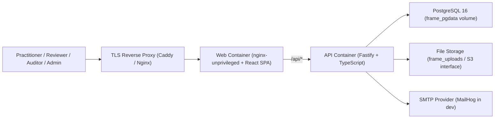
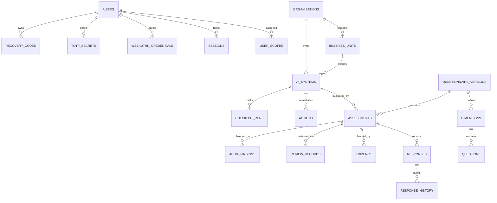

# Architecture

## System Context & Containers

## Backend Choice: Fastify vs NestJS

Fastify was chosen over NestJS for:
1. Minimal dependency surface and fast cold-start in non-root Alpine containers.
2. Explicit, auditable security middleware pipeline (`@fastify/helmet`, `@fastify/cors`, `@fastify/cookie`, `@fastify/rate-limit`, custom `authenticateRequest` / `requireFullAuth` / `requireStepUp`).
3. Native Zod validation and OpenAPI generation (`@fastify/swagger` at `/api/docs`).

## Entity Relationship Diagram (Core Domain)

